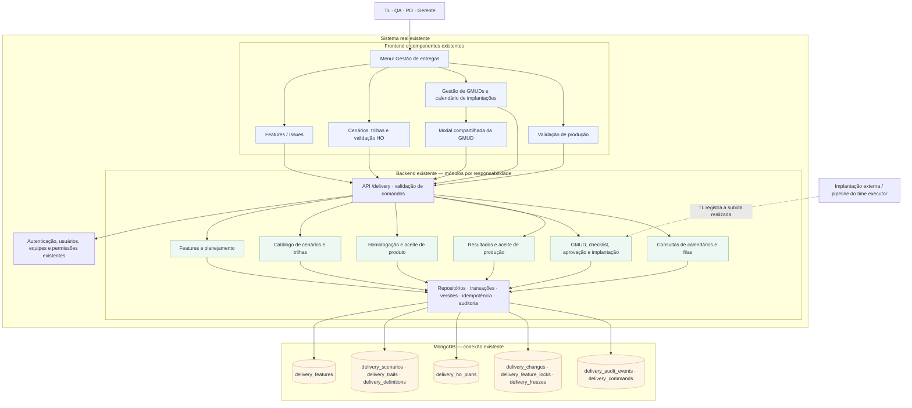

# Arquitetura proposta para o sistema real

Diagrama de integração futura. O protótipo atual continua em HTML/JavaScript com localStorage. A proposta reutiliza frontend, backend, autenticação e conexão MongoDB do sistema hospedeiro. Os blocos representam módulos da mesma aplicação, sem exigir microserviços.

## Fluxo entre as responsabilidades

```mermaid
flowchart LR
    Cadastro["TL cadastra feature / issue"] --> Catalogo["QA define cenários e trilhas"]
    Catalogo --> HO["QA / PO executam HO"]
    HO --> AceiteHO["PO registra aceite de HO"]
    AceiteHO --> GMUD["TL cria GMUD, checklist e plano de PROD"]
    GMUD --> Aprovacao["Gerente aprova a subida"]
    Aprovacao --> Deploy["Time executor realiza implantação externa"]
    Deploy --> Registro["TL confirma subida realizada"]
    Registro --> PROD["PO valida cenários e etapas em PROD"]
    PROD --> Decisao{"Resultado"}
    Decisao -->|"OK / N/A"| AceitePROD["PO conclui validação"]
    AceitePROD --> Encerramento["TL encerra GMUD"]
    Decisao -->|"Falha"| Falha["PO registra etapa e motivo; TL avalia"]
    Falha -->|"Correção da validação sem nova implantação"| PROD
    Falha -->|"Reversão necessária"| Rollback["TL registra rollback realizado"]
    Rollback --> Nova["Correção e nova GMUD para a mesma feature"]
    Nova --> HO
```

## Como ler

- A UI usa componentes e rotas do sistema real. Calendário e gestão abrem o mesmo componente de GMUD, sem iframe na integração.
- Controllers/API autenticam e delegam comandos aos módulos; regras ficam nos serviços de aplicação/domínio, não no navegador.
- As ligações à infraestrutura representam a camada de repositórios. Cada módulo acessa somente os dados de sua responsabilidade; não deve escrever livremente em todas as coleções.
- O planejamento consulta features, ambientes e componentes para calcular concorrência. Calendários e filas são consultas dos mesmos registros, sem outra coleção de timeline.
- HO e PROD guardam snapshots independentes dos cenários. PROD fica dentro do documento da GMUD; alterações são feitas pelos comandos do módulo de produção.
- Auditoria e recibos de idempotência são gravados junto da alteração operacional em transação. Versões evitam sobrescrever outra edição; locks impedem duas GMUDs ativas para a mesma feature.
- A pipeline é externa. O sistema registra a implantação realizada e seus resultados; não executa deploy nesta primeira integração.
- Mudança de código após rollback gera outra GMUD, mantendo a feature e o histórico da tentativa anterior. Correções relevantes exigem revalidar HO e obter os novos aceites.
- O catálogo é reutilizável e pode existir antes do cadastro; a sequência do segundo desenho mostra o percurso de uma entrega, não uma obrigação de recadastrar testes a cada feature.

Detalhes: [módulos](modulos.md), [modelo MongoDB](../integration/mongodb/model.md) e [guia de implementação](../IMPLEMENTAR_NO_SISTEMA.md).
